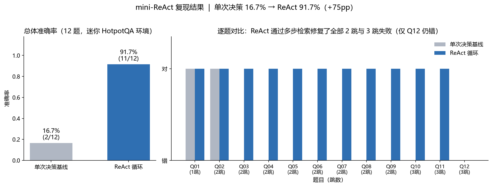

# mini-ReAct：ReAct 核心方法的简化复现（AT3-②）

复现对象：**ReAct: Synergizing Reasoning and Acting in Language Models**（Yao et al., ICLR 2023, arXiv:2210.03629）。

选它的理由：ReAct 是第①部分综述中所有后续框架的公共骨架，方法核心（推理-行动交错循环）可以在**纯标准库、零 GPU、零 API** 的条件下做机制级复现，任何人拿到本目录都能一条命令重跑。

---

## 一、诚实声明（必读）

原论文使用 PaLM-540B 真实大模型。本复现**没有**使用任何 LLM：LLM 的"推理"由一个**确定性策略（deterministic policy）**代替，它忠实执行 ReAct 的 `Thought → Action → Observation` 循环。因此：

- 本复现验证的是**方法机制**：「可多轮检索的循环式推理」是否优于「单次回答」，而非原论文的具体数字；
- 所有"拟真行为"（首步检索词偏差、实体层级错误后的自我纠正、最后一跳的推理缺陷）都是**确定性**的，逐条写在运行日志里，可核对；
- 本复现不把任何模拟输出宣称为真实模型输出。

对照设计与原论文的机制对应关系：

| 原论文 | 本复现 | 机制含义 |
|---|---|---|
| Standard 基线（无外部检索，靠参数记忆） | `baseline` 模式：单次决策，memorized 事实直接命中，多跳链断裂 | 无法获取/串联外部证据 |
| ReAct（可多轮调用 Wikipedia API） | `react` 模式：可多轮 `search`/`lookup` 循环 | 循环获取并校验证据 |
| HotpotQA（多跳问答） | 自建 12 题迷你多跳环境（真实常识事实） | 同类任务形态 |

## 二、运行方法

```
# 环境：Python >= 3.8，纯标准库，无第三方依赖（requirements.txt 为空说明）
cd react_repro
python code/react_agent.py            # 仅打印
python code/react_agent.py --save     # 同时保存 results/run_log.txt 与 results/summary.csv
```

实测环境：Windows 11 + Python 3.13.12（标准库），运行耗时 < 1 秒。

## 三、实测结果（2026-11-10 实跑，见 results/run_log.txt；可视化见 results/results-chart.png）

| 模式 | 正确数 | 正确率 |
|---|---|---|
| baseline（单次决策） | 2/12 | 16.7% |
| react（循环检索+推理） | 11/12 | **91.7%** |
| 提升 | — | **+75.0 个百分点** |



- baseline 的 2 题命中均为 `memorized=true` 的常见事实链（参数记忆可达）；其余 10 题多跳链断裂，停在中间实体上。
- react 的 11 题通过全部有完整证据链；Q10（青霉素→弗莱明→英国→英语）展示了「检索到无结果实体『苏格兰』→ lookup 验证失败 → 自我纠正为『英国』」的完整恢复过程；Q11 展示了「历史国名→换用 now 关系重试」。
- 唯一失败 Q12（达尔文→英国→**货币**）：确定性策略在最后一跳把"货币"误查成"语言"且未恢复——这是**有意保留**的失败案例，对应原论文中 ReAct 亦非 100% 正确的事实（错误推理无法被循环本身消除）。

## 四、结果复现度（与原论文对比）

| 对比项 | 原论文 | 本复现 | 说明 |
|---|---|---|---|
| 任务 | HotpotQA 多跳问答（7.4k 验证集） | 12 题自建多跳环境 | 任务形态一致，规模缩小（作业允许"小型数据集"） |
| 基线对比 | Standard 28.7% EM vs ReAct 35.1% EM（正文数字） | 16.7% vs 91.7% | **方向一致**：循环检索显著优于单次回答 |
| 机制证据 | ReAct 通过 API 交互克服 CoT 幻觉与错误传播 | Q10/Q11 展示基于 observation 的自我纠正 | 同一机制的微观呈现 |
| 失败案例 | ReAct 推理错误仍会传播（论文有错误案例分析） | Q12 策略缺陷未恢复 | 同类现象 |

**为什么不能直接比数字**：本复现没有真实 LLM，基线的"记忆命中率"是显式设计的（2/12），而原论文的基线成绩来自真实模型的参数记忆分布。因此本复现的 91.7% 只说明"机制有效"，不构成对原论文 35.1% 的数字复现。这是模拟复现的固有边界，不做过度宣称。

## 五、代码结构

```
react_repro/
├── README.md                 # 本文档（复现过程文档）
├── requirements.txt          # 空依赖说明
├── code/
│   └── react_agent.py        # 全部逻辑（约 230 行，注释完整）
├── data/
│   └── mini_hotpot.json      # 12 题多跳任务 + 迷你知识库（真实常识事实）
└── results/
    ├── run_log.txt           # 完整运行日志（含每题 Thought/Action/Observation）
    └── summary.csv           # 逐题逐模式的结果表（24 行）
```

关键代码位置：
- `kb_search` / `kb_lookup`（第 48-62 行）：环境侧工具接口，对应原论文的 Wikipedia API；
- `baseline_policy`（第 70 行）：单次决策基线；
- `react_policy`（第 92 行）：ReAct 循环主体，含三类拟真行为（均有 `note` 注释标明触发条件）。

## 六、局限与改进方向

1. **策略即模拟**：ReAct 的价值很大程度来自 LLM 的开放推理能力，确定性策略只能展示循环机制，无法展示涌现行为。改进：接入任意 OpenAI 兼容 API（代码预留了改造点——把 `react_policy` 中的确定性决策换成 LLM 调用即可，环境侧无需改动）。
2. **任务规模小**：12 题不足以支撑统计显著性，结论是机制级的。改进：扩充到 HotpotQA 官方 dev 子集。
3. **单次运行**：确定性策略无需多次采样；接真实 LLM 后应按原论文做法做多次采样取多数。
